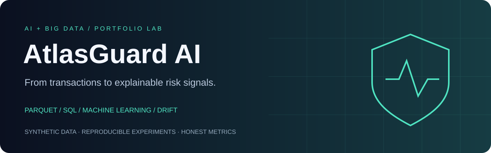
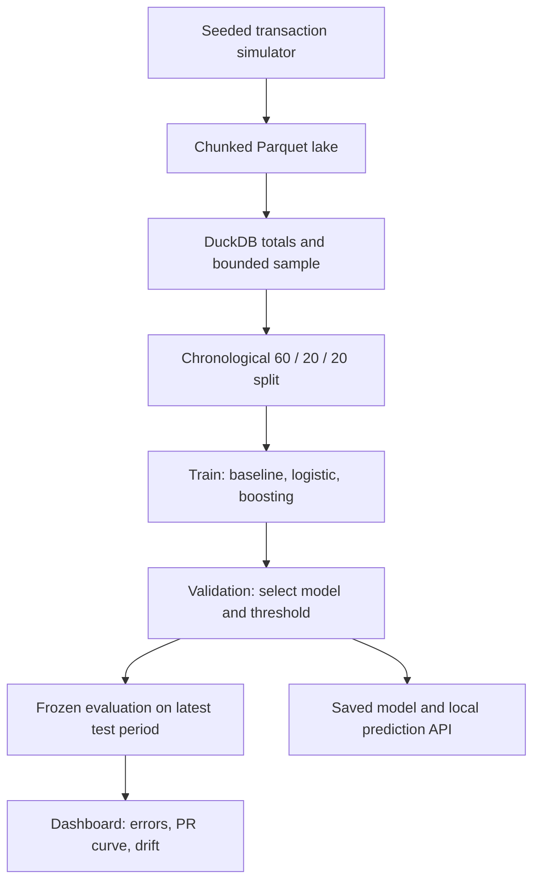
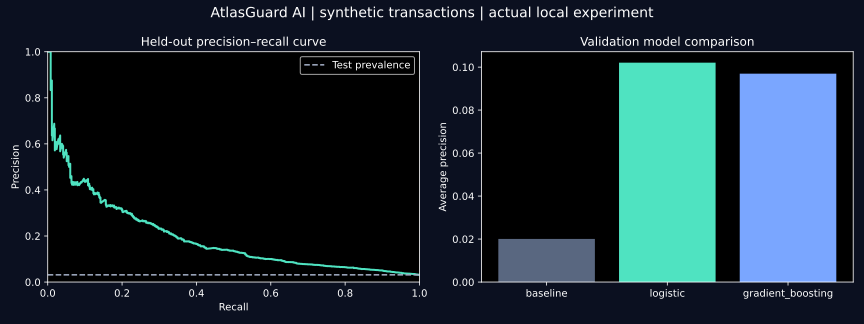

# AtlasGuard AI

### From a million transactions to explainable risk signals.



**Parquet lake · DuckDB SQL · Chronological ML · Drift monitoring · FastAPI · Interactive dashboard**

A reproducible portfolio lab by **Mohamed Abdelkoddouss Sabouh**, studying Artificial Intelligence & Big Data.
Build a transaction lake in chunks, compare models without leaking the future, inspect errors,
and serve the exact same model through a validated prediction API.

> **Synthetic data, honest evaluation.** This project is an educational simulator. It contains no real
> customer records and makes no claim of bank-grade performance. The million-row example is a local
> batch workload, not a distributed cluster or live payment stream.

## Quick start

Python 3.10+; no Docker, account, paid API or external dataset needed.

```powershell
git clone https://github.com/abdelkoddouss-sabouh/git-github-demo.git
cd git-github-demo/atlasguard-ai
python -m venv .venv
.\.venv\Scripts\python.exe -m pip install -e ".[dev]"
.\.venv\Scripts\python.exe -m atlasguard.pipeline --rows 100000
.\.venv\Scripts\python.exe -m streamlit run dashboard.py
```

Open the local URL printed by Streamlit. On Linux/macOS, replace `.\.venv\Scripts\python.exe`
with `.venv/bin/python`. A run preserves previous outputs: use `--output artifacts-second` for another
experiment and set `ATLAS_ARTIFACTS` to that directory for the dashboard/API.

For the million-row experiment:

```powershell
.\.venv\Scripts\python.exe -m atlasguard.pipeline --rows 1000000 --max-train-rows 100000 --output artifacts-million
$env:ATLAS_ARTIFACTS="artifacts-million"
.\.venv\Scripts\python.exe -m streamlit run dashboard.py
```

Data generation writes 25,000-row chunks. DuckDB scans all partitions for SQL totals and selects
a deterministic, time-spread sample. Only the bounded sample is materialized for scikit-learn.
This limits model-training memory; it does not promise constant-memory SQL or distributed scale.
On machines with many CPU cores, setting `OMP_NUM_THREADS=2` and `OPENBLAS_NUM_THREADS=2`
before starting Python can reduce thread contention; CI uses these limits.

## The experiment



| Decision | Implementation | Why it matters |
|---|---|---|
| Rare positives | Average precision + precision/recall | Accuracy can hide missed fraud |
| Future leakage | Chronological splits; train-only scaling | Later transactions cannot train the model |
| Model selection | Validation average precision | Test data does not choose the winner |
| Alert threshold | Validation F1 | Explicit operating point; not an assumed 0.5 |
| Baseline | Prior-only dummy classifier | Makes improvements measurable |
| Explanation | Validation permutation importance | Global predictive relevance, not causality |
| Monitoring | Train-to-test feature PSI | Describes drift without claiming model failure |
| Serving | API–batch parity test | Same features and model at inference |

The dashboard includes a precision–recall curve, confusion matrix, validation leaderboard,
review queue with CSV download, hypothetical error-cost inputs and a feature drift view.
Changing the threshold in the dashboard is exploratory; the published test metrics retain the
threshold chosen on validation.

## Reproduced results

| Actual local example | Result |
|---|---:|
| Synthetic lake rows | 1,000,000 |
| ML sample (train / validation / test) | 60,000 / 20,000 / 20,000 |
| Validation-selected winner | Logistic regression |
| Held-out average precision | 0.1916 |
| Held-out ROC-AUC | 0.7936 |
| Precision / recall at validation-selected threshold | 13.77% / 48.80% |
| Test fraud prevalence | 3.135% |

The false-alert burden is substantial: 1,917 false positives and 321 missed frauds in this test.
That is a reason for further investigation and realistic data validation, not a deployment claim.

See [the committed experiment record](examples/report.json) and [evaluation figure](assets/evaluation.svg).
These files are generated by an actual local run; the seed, versions, split sizes, lake fingerprint,
validation comparison and held-out metrics are recorded. Regenerate your own results instead of
treating synthetic performance as evidence about real fraud.



## Prediction API

After generating local artifacts, run in a second terminal:

```powershell
.\.venv\Scripts\python.exe -m uvicorn atlasguard.api:app --host 127.0.0.1 --port 8000
```

Open `http://127.0.0.1:8000/docs`, choose `POST /predict` and try:

```json
{"amount":350,"hour":2,"distance_km":120,"attempts_1h":5,"account_age_days":20,"international":1,"new_device":1}
```

The response includes a model score, alert decision, threshold and synthetic-training notice.
Scores are not demonstrated to be calibrated real-world fraud probabilities. The service has no
authentication and is intended for localhost. Load only `model.joblib` artifacts you created and trust.

## Tests

```powershell
.\.venv\Scripts\python.exe -m pytest -q
```

Tests cover deterministic data, full-lake SQL counts, bounded sampling, temporal separation,
data validation, threshold metrics, pipeline artifacts, preservation of previous runs,
API–batch score parity and invalid requests. CI runs the suite on Python 3.10 and 3.12.

## Understand it, then extend it

- [French learning path: comprendre et présenter le projet](docs/APPRENDRE.md)
- [Model card: intended use and limits](MODEL_CARD.md)
- [Data contract and generator assumptions](docs/DATA.md)
- [Contributing and useful next steps](CONTRIBUTING.md)

Start by explaining one false positive and one false negative. Then change one assumption, rerun
with a new output directory and compare the validation and test results. A useful next step is a
licensed real dataset with a documented mapping to this feature contract; that integration is not
implemented in this version.

References: [scikit-learn leakage guidance](https://scikit-learn.org/stable/common_pitfalls.html),
[average precision](https://scikit-learn.org/stable/modules/generated/sklearn.metrics.average_precision_score.html),
[DuckDB Parquet](https://duckdb.org/docs/stable/data/parquet/overview.html).

Released under the repository's [MIT license](../LICENSE).
